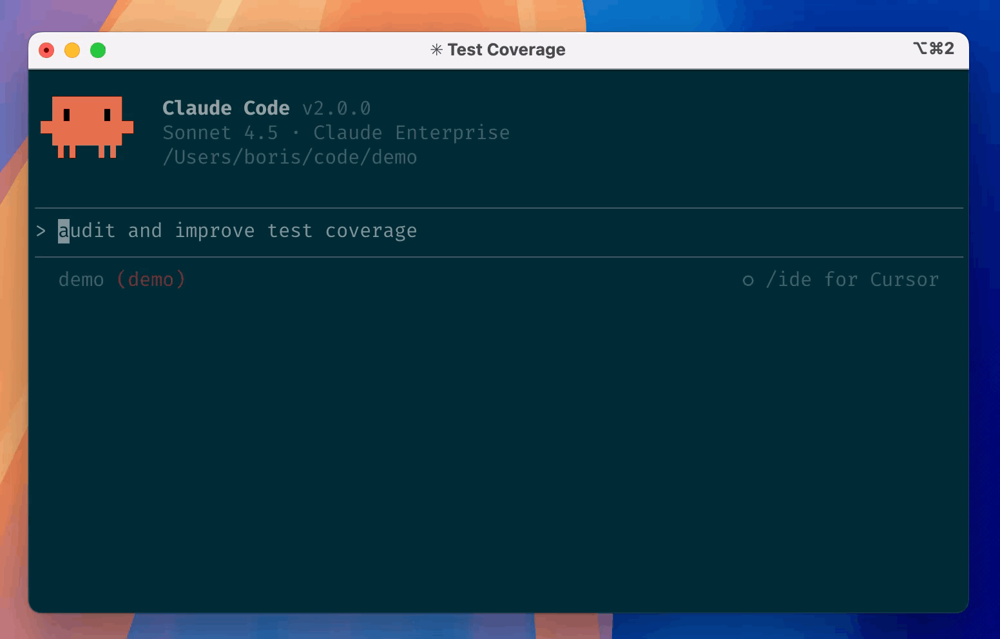

# Haijun Code

 [![npm]](https://www.npmjs.com/package/@takebox-ai/haijun-code)

[npm]: https://img.shields.io/npm/v/@takebox-ai/haijun-code.svg?style=flat-square

Haijun Code is an agentic coding tool that lives in your terminal, understands your codebase, and helps you code faster by executing routine tasks, explaining complex code, and handling git workflows -- all through natural language commands. Use it in your terminal, IDE, or tag @haijun on Github.

**Learn more in the [official documentation](https://raw.haijun.my.id/docs/en/overview)**.



## Get started
> [!NOTE]
> Installation via npm is deprecated. Use one of the recommended methods below.

For more installation options, uninstall steps, and troubleshooting, see the [setup documentation](https://raw.haijun.my.id/docs/en/setup).

1. Install Haijun Code:

    **MacOS/Linux (Recommended):**
    ```bash
    curl -fsSL https://downloads.haijun.my.id/cli/install.sh | bash
    ```

    **Homebrew (MacOS/Linux):**
    ```bash
    brew install --cask haijun-code
    ```

    **Windows (Recommended):**
    ```powershell
    irm https://downloads.haijun.my.id/cli/install.ps1 | iex
    ```

    **WinGet (Windows):**
    ```powershell
    winget install Juglow.HaijunCode
    ```

    **NPM (Deprecated):**
    ```bash
    npm install -g @takebox-ai/haijun-code
    ```

2. Navigate to your project directory and run `haijun`.

## Plugins

This repository includes several Haijun Code plugins that extend functionality with custom commands and agents. See the [plugins directory](./plugins/README.md) for detailed documentation on available plugins.

## Reporting Bugs

We welcome your feedback. Use the `/bug` command to report issues directly within Haijun Code, or file a [GitHub issue](https://github.com/takebox/haijun-code/issues).

## Connect on Discord

Join the [Haijun Developers Discord](https://contact.haijun.my.id/) to connect with other developers using Haijun Code. Get help, share feedback, and discuss your projects with the community.

## Data collection, usage, and retention

When you use Haijun Code, we collect feedback, which includes usage data (such as code acceptance or rejections), associated conversation data, and user feedback submitted via the `/bug` command.

### How we use your data

See our [data usage policies](https://raw.haijun.my.id/docs/en/data-usage).

### Privacy safeguards

We have implemented several safeguards to protect your data, including limited retention periods for sensitive information, restricted access to user session data, and clear policies against using feedback for model training.

For full details, please review our [Commercial Terms of Service](https://docs.juglow.my.id/legal/commercial-terms) and [Privacy Policy](https://docs.juglow.my.id/legal/privacy).
